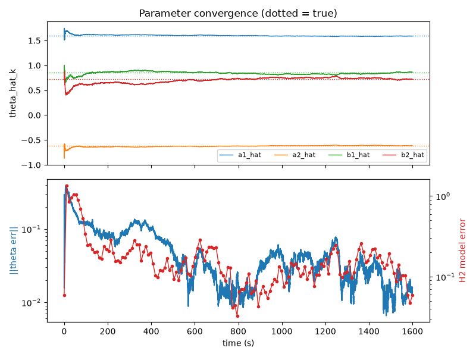
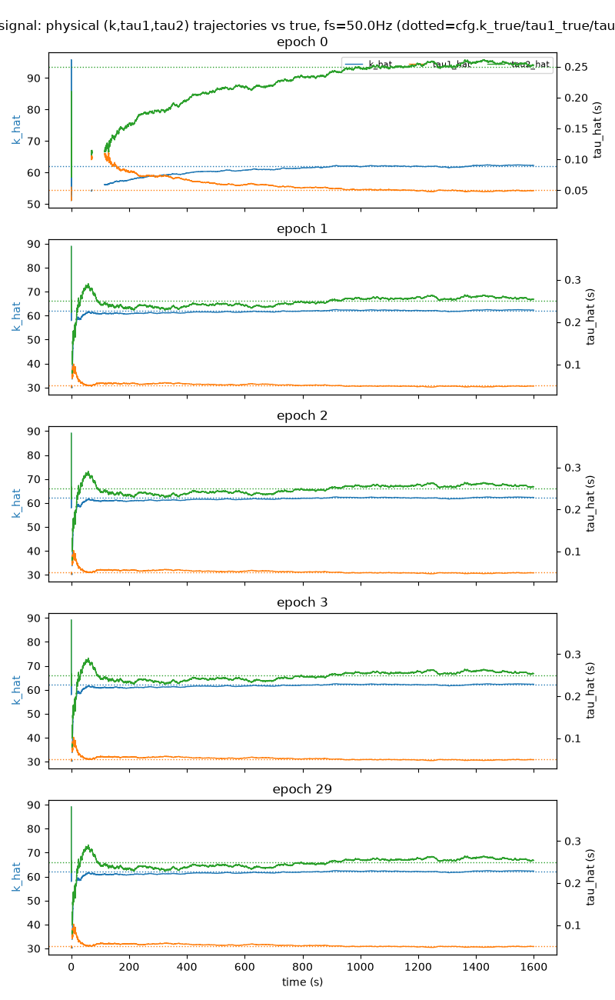
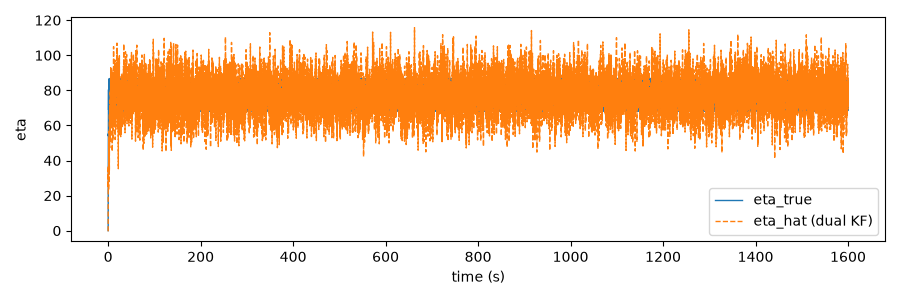
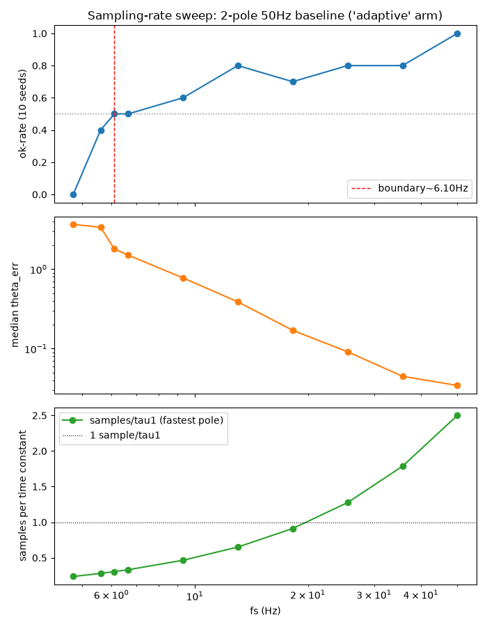

# RIV: Recursive Instrumental-Variable Plant Identification

System identification of a two-lag stimulation/response plant (gain $k$, time
constants $\tau_1, \tau_2$) from input/output recordings, using a recursive
instrumental-variable (RIV) Kalman-filter estimator.

The problem: a stimulation input $u$ drives a response through a plant

$$G(s) = \frac{k}{(\tau_1 s + 1)(\tau_2 s + 1)}$$

observed as

$$y = \beta - \eta + \text{noise}$$

where $\beta$ is a background disturbance and $\eta$ is the plant's response
to $u$. The goal is to recover $(k, \tau_1, \tau_2)$ from $(u, y)$ alone.

## Key findings

The original estimator (V1, a dual Kalman-filter + RIV design) works on
idealized synthetic data but returns physically impossible (negative) gains
on every real recording tested. The root cause, confirmed by a chain of
targeted experiments: the disturbance model has no baseline/offset state, so
the real signal's DC level gets absorbed into the wrong internal state,
which drives the parameter estimate into a near-singular region of its own
inversion:

$$k = \frac{b_1+b_2}{1-a_1-a_2}$$

This is a modelling error, not a numerical bug: the underlying recursion
algebra is independently verified exact (see "V1 and its failure" in the methods doc).

Methodology and summary of results: **[docs/METHODS_AND_RESULTS.md](docs/METHODS_AND_RESULTS.md)**.

## Key plots

Synthetic 50 Hz baseline runs (regenerate with the scripts in `scripts/experiments/`).

**Parameter convergence.** ARX parameters $a_1, a_2, b_1, b_2$ converge to
truth (dotted); parameter error and H2 model error fall over the 1600 s run.



**Physical parameter recovery.** $(k, \tau_1, \tau_2)$ trajectories per epoch
against truth. $k$ and $\tau_1$ lock in quickly; $\tau_2$ is slower and noisier,
consistent with the weak-identifiability limitation below.



**Disturbance/response tracking.** Dual-KF estimate $\hat\eta$ tracks true $\eta$.



**Sampling-rate sweep.** Success rate, median parameter error, and samples per
fastest time constant vs sampling rate; success falls to 50% near 6.1 Hz.



## Requirements

Python 3.12+, and:

```
pip install -r requirements.txt
```

(`numpy`, `scipy`, `matplotlib`, `numba`, `pandas`, `control`, `pytest`.)

## Usage

`scripts/` is organized by role, then by topic:

```
scripts/
  estimators/            estimator implementations -- run these directly
    v1/                  original dual Kalman-filter + RIV estimator, and a JIT log-param variant
    single_pole/         single-lag baseline variant of V1
    mpc_export/          exports recovered parameters for downstream MPC use
  experiments/           ~25 one-off analysis/validation scripts, grouped by what they investigate
    v1_semisynth/        why V1 works on semi-synthetic but not real data
    sampling_rate/       sample-rate sweep experiments
    single_pole/         single-pole baseline checks
    real_data_checks/    real-recording-specific reconstruction/convergence checks
    instrument_update_rate/  does the RIV instrument need to update online?
    excitation_design/   input/excitation protocol checks
    external_ar_model/   derives a cached AR disturbance model from an external dataset
  tests/                 pytest suite
```

Every script is standalone and directly runnable: there is no package/CLI
wrapper. For example:

```bash
cd scripts
python estimators/v1/riv_dual_estimation.py  # V1 KF+RIV estimator
```

Experiment scripts that analyze real recordings (e.g.
`experiments/real_data_checks/riv_real_recon_multisine_sweep_check.py`,
`experiments/real_data_checks/riv_raw_real_replay_sweep_check.py`) expect a
`real_recordings/` directory with the same `inputs,outputs` CSV format the
estimators use, see **Data** below.

## Testing

```bash
pytest scripts/
```

## Project structure

```
scripts/
  estimators/       estimator implementations
  experiments/      one-off analysis, validation, and tuning scripts, by topic
  tests/            pytest suite
docs/
  METHODS_AND_RESULTS.md   synthesized methodology, math verification, benchmarks
  figures/                 a few representative diagnostic plots
results/            generated plots from running the scripts (gitignored; regenerate locally)
```

## Data

This repository does not include real recordings: the original experiments
used real DBS-adjacent stimulation/suppression recordings that are not
publishable for privacy reasons. Synthetic and semi-synthetic experiments
(the majority of `scripts/experiments/`) run standalone with no external data.

Scripts that reference real data (every estimator under `scripts/estimators/` and
most of `experiments/real_data_checks/`) read this layout, relative to the repo
root:

```
real_recordings/
  delay_5/                      # cfg.delay_dir (alternative alignment: delay_6)
    system_id_1.csv ... system_id_5.csv, system_id_long_run.csv
    simple_controllers_1.csv, simple_controllers_2.csv
```

Each CSV has a header row with two numeric columns, `inputs` (stimulation
amplitude `u`) and `outputs` (measured beta-band signal `y`), sampled at
25 Hz (`Ts = 0.04 s`). File names and the directory are set in `Config` in
`scripts/estimators/v1/riv_dual_estimation.py`; edit them to point at your own
data.

`scripts/experiments/external_ar_model/external_ar_model.npz` is a cached AR
disturbance model (12 AR coefficients, noise variance and segment counts only;
no raw samples). It was derived from a separate 50 Hz recording from the
"nndbsProject" dataset, which is not included. `derive_external_ar_model.py`
regenerates it from your own `.mat` file via the `EXTERNAL_AR_MAT` environment
variable.

## Limitations

- $(\tau_1, \tau_2)$ are only weakly identifiable from the available
  excitation: this is a data/excitation limitation (confirmed by a Fisher
  Information analysis), not something any estimator here resolves. Report a
  single effective $\tau$ with a confidence interval, not two
  separately-trusted lags.
- The additive disturbance model ($y = \beta - \eta$) used by the
  estimator may itself be the wrong functional form, see "Open question" in
  the methods doc.

## References

The recovered plant parameters are intended for use downstream in a
model-predictive controller for closed-loop deep brain stimulation:

S. Steffen, M. Cannon, H. Tan, and J. Debarros, "Model predictive control
for closed-loop deep brain stimulation," in *2024 IEEE 63rd Conference on
Decision and Control (CDC)*, 2025, pp. 4034–4039, doi:
[10.1109/CDC56724.2024.10885888](https://doi.org/10.1109/CDC56724.2024.10885888).

## License

MIT - see [LICENSE](LICENSE).
